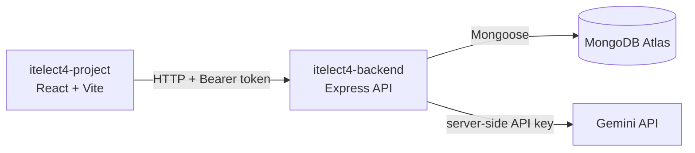

# Cyber Incident Response Simulator

[](https://github.com/bayie27/itelect4-project/actions/workflows/ci.yml)

The Cyber Incident Response Simulator (CIRS) is a semester-long web application for practicing fictional cybersecurity incident-response workflows. Responders inspect evidence and complete response actions while an incident commander creates scenarios, coordinates the team, controls the incident lifecycle, and generates post-incident reports.

CIRS is an educational simulation. It does not scan systems, execute commands, analyze real malware, or use real organizational data.

## Live deployments

- **Frontend:** [itelect4-project-roan.vercel.app](https://itelect4-project-roan.vercel.app)
- **Backend:** [itelect4-backend-roan.vercel.app](https://itelect4-backend-roan.vercel.app)

## Architecture



## Course fit

| Requirement | CIRS implementation |
|---|---|
| At least three core entities | `User`, `Incident`, `ResponseAction`, and `Evidence` |
| Entity with a two-to-three-value role field | `User.role`: responder or incident commander |
| Multi-step status lifecycle | Incident and response-action status enums |
| List-to-detail routing | Incident list to incident command room |
| Real-time feature | Response-action creation and status updates |
| Generative-text feature | Versioned Gemini post-incident reports |
| Solo-buildable | Fictional data, limited workflows, no payments or external security integrations |

## Semester MVP

The final application must let a user:

1. Register, sign in, and access role-appropriate controls.
2. View incidents and open an incident command room.
3. Create and reveal fictional evidence.
4. Propose, approve, assign, start, reject, and complete response actions.
5. Move an incident through valid lifecycle stages.
6. Receive response-action updates without refreshing.
7. Resolve an incident after every non-rejected action is completed.
8. Generate and revisit versioned AI-assisted post-incident reports.
9. Use the deployed application successfully.

## Documentation

- [Product specification](docs/product-spec.md): users, entities, rules, workflows, and scope
- [Semester roadmap](docs/semester-roadmap.md): module deliverables, deadlines, and decision gates
- [Technical reference](docs/technical-reference.md): architecture, API, real-time, AI, testing, and deployment

Each topic has one canonical home. Update the relevant document when a product rule, milestone, or technical contract changes.

## Current milestone

The CIRS frontend connects to the separate Express backend for registration, login, and creator-scoped incident data. It uses short-lived Bearer JWTs, persisted Zustand authentication state, TanStack Query server state, React Hook Form, Zod runtime validation, and the existing Shadcn UI components. The protected review page requests server-generated, versioned reports for fictional resolved incidents. GT6 adds Vitest coverage and GitHub Actions checks for every push.

Canonical shared types live in `src/types/index.ts`, reusable lifecycle rules live in `src/domain/rules.ts`, and the original conversion exercise remains isolated under `src/gt1`. The CIRS application uses `User`, `Incident`, `ResponseAction`, and `Evidence` as its domain entities.

## Types defined so far

Interfaces:

- `User`, `Incident`, `ResponseAction`, and `Evidence` for the CIRS application
- `ApiResponse<T>`, `PaginatedResponse<T>`, and `ApiError` for API data

Enums:

- `UserRole`
- `IncidentSeverity`
- `IncidentStatus`
- `ResponseActionStatus`
- `EvidenceType`

Type aliases and utility types:

- `ID`, `ISODateString`, and `ActionPriority`
- `CreateIncidentInput`, `UpdateIncidentInput`, and `IncidentSummary`
- `CreateResponseActionInput`, `UpdateResponseActionInput`, and `CreateEvidenceInput`
- `PublicUser`, `RoleCount`, and generic `EntityById<T>`

The generic `getById<T>` function in `src/index.ts` demonstrates reusable typed lookup behavior.

## Current commands

Install dependencies:

```bash
npm install
```

Configure the frontend API origin in an ignored local environment file:

```powershell
Copy-Item .env.example .env.local
```

Set `VITE_API_URL=http://localhost:4000` in `.env.local`, then run the backend from the separate `itelect4-backend` repository and start Vite:

```bash
npm run dev
```

Type-check the project:

```bash
npx tsc --noEmit
```

Run lint, tests, and the production build:

```bash
npm run lint
npm test
npm run build
```

For watch mode while editing tests, run `npm run test:watch`.

Registration and login call `/api/auth/register` and `/api/auth/login`. Private incidents, response actions, and evidence use the authenticated backend API. The frontend sends the persisted Bearer token through `src/api/client.ts`; the backend remains authoritative for owner scoping, validation, and evidence reveal permissions. Use fictional names, email addresses, and passwords for training accounts.

For Vercel, set `VITE_API_URL` to the backend origin (no `/api` suffix or trailing slash). Vite reads this value at build time. After the frontend receives its deployment URL, set the backend's `CORS_ORIGIN` to that exact origin and redeploy the backend. Follow the backend README for Atlas, Vercel, and the owner-scoped demo seed steps.
